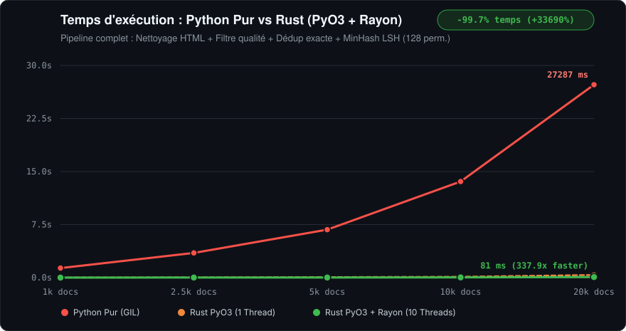
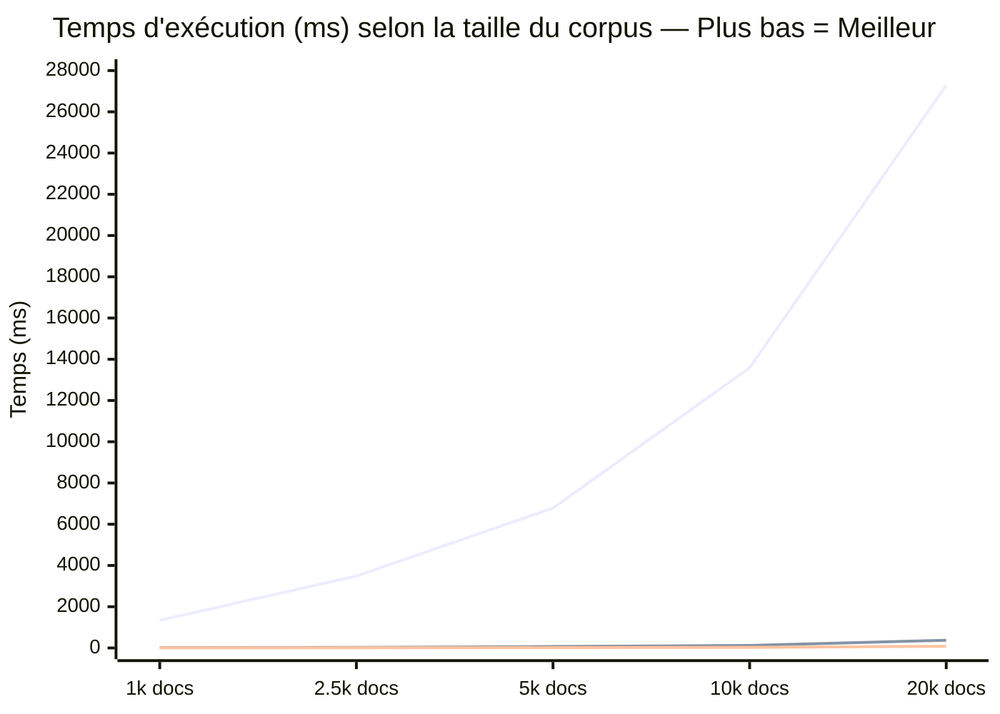
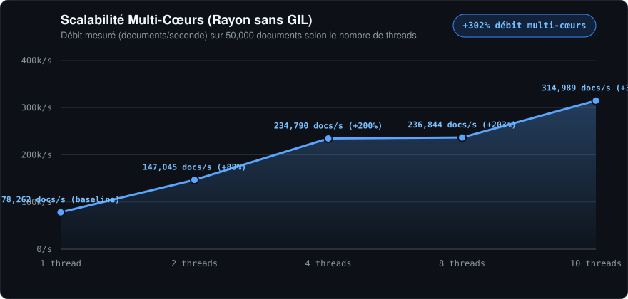
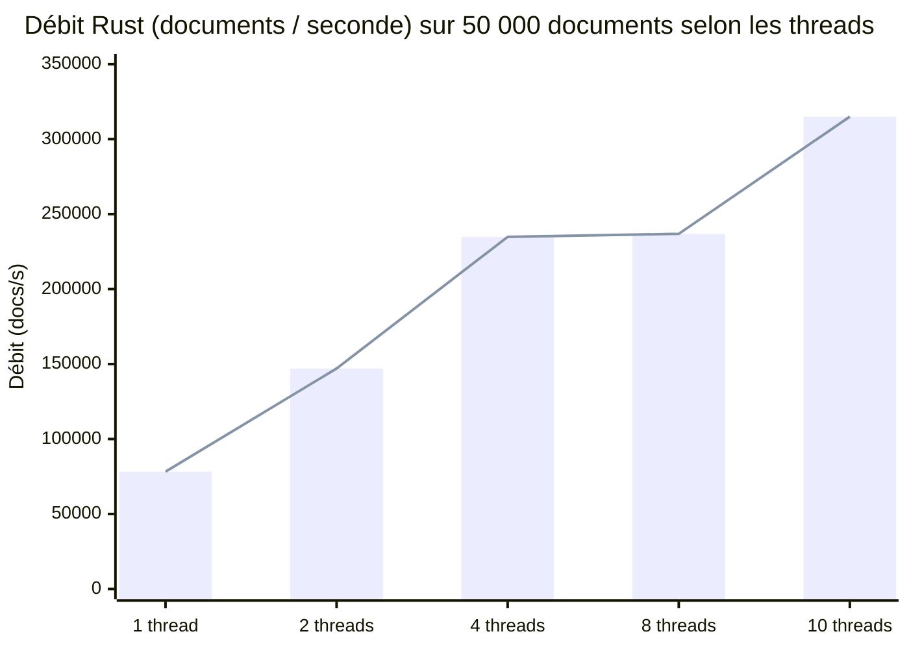
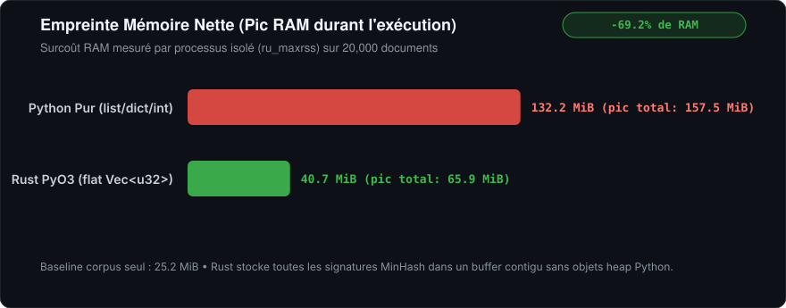

# `llm-dedup-rs` — Nettoyage & Déduplication de Datasets LLM en Rust (`PyO3` + `Rayon`)

[](https://www.rust-lang.org/)
[-blue?logo=python)](https://pyo3.rs/)
[](https://github.com/rayon-rs/rayon)
[-brightgreen)](#benchmarks-réels--courbes-de-performance)
[](#empreinte-mémoire-ram)

Un moteur haute performance de **prétraitement et déduplication de corpus LLM** (nettoyage HTML, filtrage qualité, déduplication exacte 64-bit et déduplication floue **MinHash + LSH**), écrit en **Rust** et exposé nativement à **Python** via `PyO3`.

Ce projet démontre concrètement pourquoi l'écosystème **Data & IA** (*Polars*, *Ruff*, *uv*, *Hugging Face Tokenizers*) adopte massivement Rust pour remplacer les goulots d'étranglement CPU/mémoire en Python pur.

---

## Pourquoi Rust en Data & IA ?

| Goulot d'étranglement en Python Pur | Solution apportée par Rust (`PyO3` + `Rayon`) | Gain mesuré sur ce projet |
| :--- | :--- | :--- |
| **GIL (Global Interpreter Lock)** bloqué sur 1 seul cœur CPU | Libération du GIL (`py.allow_threads`) + parallélisme de données `Rayon` | **+302.5 % de débit** entre 1 et 10 threads |
| **Objets heap Python** (`int` = 28 octets, `list`/`dict` dispersés) | Allocation contiguë unique `Vec<u32>` pour toutes les signatures MinHash | **-69.2 % de RAM nette** |
| **Boucles interprétées** sur millions de 5-grammes | Code machine LLVM (`--release`) + hachage 64-bit `FxHash` zéro-GC | **337.9× à 521.9× plus rapide** (**-99.7 % à -99.8 % de temps**) |

---

## Benchmarks Réels & Courbes de Performance

> Mesures exécutées sur Apple Silicon (`10` threads logiques Rayon, Python `3.11.14`, Rust `--release`, 128 permutations MinHash, 16 bandes LSH, seuil Jaccard `0.80`). Données brutes dans [`benchmarks/results.json`](benchmarks/results.json).

### 1. Temps d'exécution : Python Pur vs Rust (`PyO3` + `Rayon`)



#### Courbe interactive GitHub (Mermaid `xychart-beta`)



| Taille du corpus | Python Pur (ms) | Rust 1 Thread (ms) | Rust 10 Threads (ms) | Accélération (`×`) | Gain en `%` | Réduction du temps |
| :---: | :---: | :---: | :---: | :---: | :---: | :---: |
| **1 000 docs** | 1 345.65 ms | 12.96 ms | **3.63 ms** | **370.8×** | **+36 977.5 %** | **-99.73 %** |
| **2 500 docs** | 3 488.50 ms | 30.53 ms | **6.68 ms** | **521.9×** | **+52 091.2 %** | **-99.81 %** |
| **5 000 docs** | 6 782.33 ms | 65.90 ms | **14.63 ms** | **463.6×** | **+46 256.6 %** | **-99.78 %** |
| **10 000 docs** | 13 585.96 ms | 123.97 ms | **26.46 ms** | **513.4×** | **+51 240.4 %** | **-99.81 %** |
| **20 000 docs** | 27 286.82 ms | 372.35 ms | **80.75 ms** | **337.9×** | **+33 690.4 %** | **-99.70 %** |

---

### 2. Scalabilité Multi-Cœurs (50 000 documents)

Rust contourne complètement le GIL Python grâce à `rayon` et exploite tous les cœurs CPU sans *data race* garantie à la compilation.





| Threads Rayon | Temps sur 50 000 docs | Débit mesuré | Gain vs 1 thread (`%`) |
| :---: | :---: | :---: | :---: |
| **1 thread** | 638.88 ms | 78 262 docs/s | baseline (`0.0 %`) |
| **2 threads** | 340.03 ms | 147 045 docs/s | **+87.9 %** |
| **4 threads** | 212.96 ms | 234 790 docs/s | **+200.0 %** |
| **8 threads** | 211.11 ms | 236 844 docs/s | **+202.6 %** |
| **10 threads** | **158.74 ms** | **314 989 docs/s** | **+302.5 %** |

---

### 3. Empreinte Mémoire (RAM)

Mesurée via `resource.getrusage(RUSAGE_SELF).ru_maxrss` dans des processus isolés sur **20 000 documents** (baseline corpus seul : `25.22 MiB`).



| Implémentation | Pic RSS Total | Surcoût Net RAM | Économie de RAM (`%`) |
| :--- | :---: | :---: | :---: |
| **Python Pur** (`list`/`dict`/`int` objets heap) | 157.47 MiB | 132.25 MiB | — |
| **Rust `PyO3`** (buffer plat `Vec<u32>`) | **65.91 MiB** | **40.69 MiB** | **-69.2 % net** (**-58.1 % total**) |

---

### 4. Répartition du Filtrage & Déduplication (Corpus 20 000 docs)

| Étape du pipeline | Documents traités | Pourcentage du corpus |
| :--- | :---: | :---: |
| Documents en entrée | 20 000 | `100.00 %` |
| Rejetés par filtre qualité (bruit HTML / texte court) | 1 000 | **5.00 %** |
| Doublons exacts supprimés (`FxHash` 64-bit) | 4 000 | **20.00 %** |
| Quasi-doublons flous supprimés (`MinHash` + `LSH`, seuil `0.80`) | 2 998 | **14.99 %** |
| **Corpus final propre et unique conservé** | **12 002** | **60.01 %** |

---

## Utilisation en Python

```python
import llm_dedup_rs

raw_docs = [
    "<article>Rust accelerates LLM data preprocessing pipelines cleanly.</article>",
    "  <div>RUST ACCELERATES LLM DATA PREPROCESSING PIPELINES CLEANLY.</div> ",
    "<article>Rust accelerates LLM data preprocessing pipeline cleanly!</article>",
    "12345 !!! ???",  # Filtré par qualité
]

clean_docs, stats = llm_dedup_rs.run_full_pipeline(
    raw_docs,
    min_chars=20,
    min_alpha_ratio=0.50,
    threshold=0.80,
    num_perm=128,
    bands=16,
)

print(stats)
# PipelineStats(total=4, kept=1, retention=25.0%, exact_removed=1, fuzzy_removed=1, ...)
```

Fonctions unitaires également disponibles :
- `llm_dedup_rs.clean_corpus(docs)` — Suppression HTML + normalisation d'espaces en parallèle.
- `llm_dedup_rs.deduplicate_exact(docs)` — Déduplication exacte `FxHash` 64-bit.
- `llm_dedup_rs.deduplicate_minhash(docs, threshold=0.80, num_perm=128, bands=16)` — Déduplication floue MinHash + LSH.

---

## Architecture du Projet

```text
llm-dedup-rs/
├── Cargo.toml                  # Configuration crate cdylib/rlib (PyO3 + Rayon + rustc-hash)
├── pyproject.toml              # Build Maturin (abi3-py39)
├── src/
│   └── lib.rs                  # Cœur Rust : nettoyage, FxHash, MinHash LSH plat & tests unitaires
├── python/llm_dedup_rs/
│   ├── __init__.py             # API Python publique
│   └── py_baseline.py          # Référence pure Python équivalente pour benchmark honnête
├── benchmarks/
│   ├── run_benchmarks.py       # Suite de benchmarks temps/threads/RSS + générateur SVG
│   └── results.json            # Résultats exacts exportés en JSON
├── assets/                     # Courbes SVG vectorielles générées automatiquement
└── tests/
    └── test_dedup.py           # Tests d'intégration et d'équivalence Rust <-> Python
```

---

## Reproduire localement (Tests & Benchmarks)

```bash
# 1. Créer l'environnement virtuel et installer maturin + pytest
uv venv .venv
uv pip install --python .venv/bin/python maturin pytest

# 2. Vérifier le code Rust (format, linter strict, tests unitaires)
cargo fmt --all -- --check
cargo clippy --all-targets -- -D warnings
cargo test

# 3. Compiler le module Rust en mode optimisé --release et lancer pytest
.venv/bin/maturin develop --release
.venv/bin/pytest -v

# 4. Lancer les benchmarks et régénérer les courbes SVG + JSON
.venv/bin/python benchmarks/run_benchmarks.py
```
